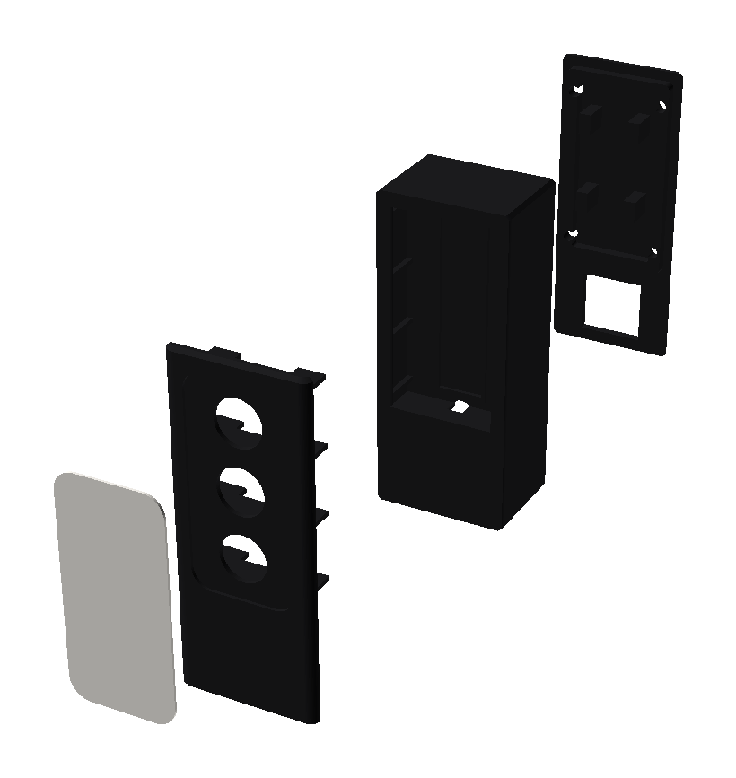
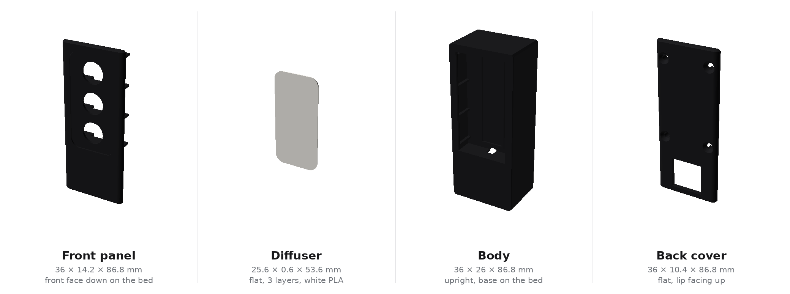
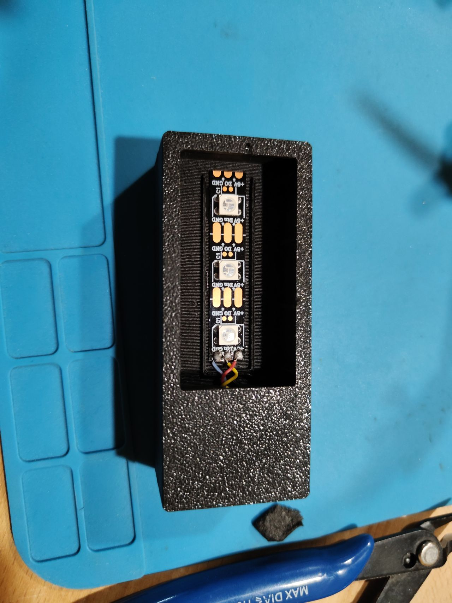
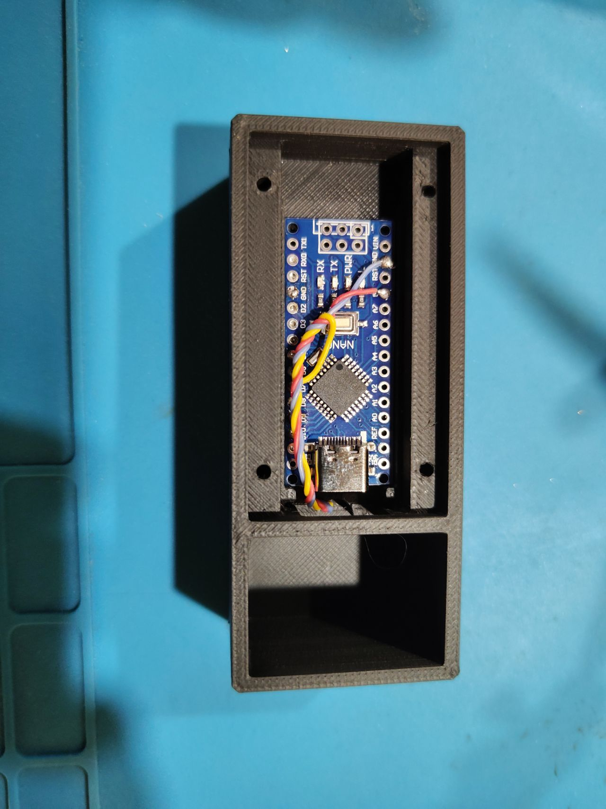
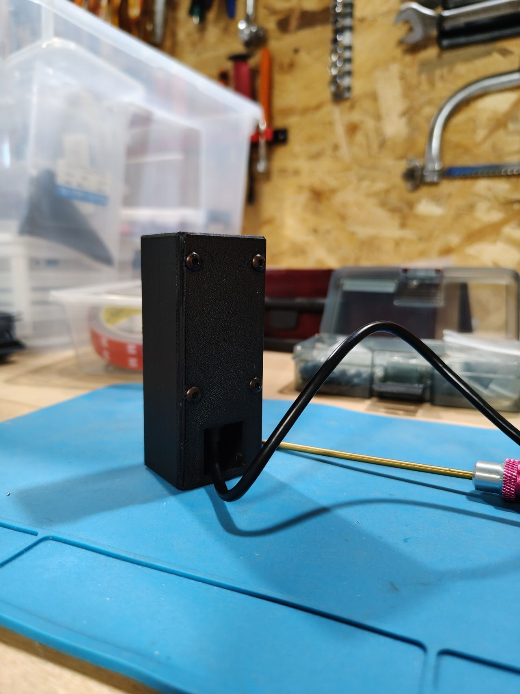

# Claude Code status light — assembly (v7)

Assembled footprint: **36 × 30.4 × 86.8 mm**.

60 LED/m strip: **16.67 mm** pitch between LEDs, so a 3-LED segment is **50 mm**
long. The three windows are Ø12 mm.

The three shell parts are cut from a single master volume: the outer profile
is continuous from one part to the next, with no step at the joints. Vertical
edges rounded at R3, 1 mm edge break top and bottom.

The cable bay floor is solid and the cable exit is raised 3.5 mm: the
enclosure sits flat on its full footprint, the cable doesn't bear on the desk.

The faceplate is separate from the body: the optical chamber opens from the
front, so the strip is glued flat against the back wall before closing it up.
The anti-crosstalk fins are carried by the faceplate and straddle the strip.

## Parts

| File | Qty | Material |
|---|---|---|
| `traffic_light_body_black.stl` | 1 | opaque PLA |
| `traffic_light_faceplate_black.stl` | 1 | opaque PLA |
| `traffic_light_diffuser_white.stl` | 1 | white / translucent PLA |
| `traffic_light_cover_black.stl` | 1 | opaque PLA |

Hardware: 4 × M3, 8–10 mm (Ø2.5 pilot holes already in place). Self-tapping
isn't required — regular threaded machine screws work fine in these holes too.

## Printing

- **Body**: upright, base on the plate. No supports. About a 24 mm bridge
  under the floor, above the cable bay — nothing critical in PLA.
- **Faceplate**: laid on its front face, fins facing up. No supports. The
  1 mm edge break at the bottom of the part sits flat on the plate just fine.
- **Diffuser**: flat. 0.6 mm = 3 layers at 0.2 mm, 3 perimeters, 100% infill.
- **Cover**: flat plate, lip facing up. No supports.

The diffuser is 0.6 mm for a 0.8 mm recess: that leaves 0.2 mm for glue and it
sits flush. If you find it still too opaque, drop `diff_t` to 0.4 mm
(2 layers) in the `.scad`.

## Wiring

WS2812B strip, 3-LED segment = 50 mm (16.67 mm pitch):

| Strip | Nano |
|---|---|
| 5V | 5V |
| GND | GND |
| DIN | D6 |

The 3 LEDs draw ~180 mA max at full white, USB is enough. No need for a
resistor on DIN or a capacitor on this build (3 LEDs, short wire, closed
enclosure) — optional reliability bonus if the strip ever grows: a 330 Ω
resistor in series on DIN, a 1000 µF capacitor between 5V and GND as close to
the strip as possible.

## Assembly

1. Glue the strip to the back wall through the front opening. A bottom stop
   and two side lugs give the exact position, adhesive against the wall, LEDs
   facing forward.
2. Route the three wires through the Ø6 hole below the strip, into the Nano
   compartment.

   

3. Glue the diffuser into the faceplate's recess.
4. Fit the faceplate onto the front of the body (centering frame, 0.35 mm
   clearance per side) and glue it. Its fins land on either side of the strip.
5. Slide the Nano in from the back between the rails, USB-C facing down,
   components facing back. The connector lands right at the floor opening.

   

6. Close the cover, its 4 pads press the board down. Screw it in.
7. Plug in the USB-C cable: the plug passes through the base's rear window
   (18 × 17 mm, plenty of room for a 12 × 7 mm overmold), goes up into the
   bay and plugs in from underneath into the connector. The cable exits
   through the same window, 3.5 mm above the resting plane.

   

## Tweaks

Parameters at the top of `traffic_light.scad`: `led_pitch` (33.33 for 30
LED/m, 6.94 for 144 LED/m — strip length, enclosure height and window
position follow automatically), `nano_l` / `nano_w` (a different board),
`win_d` (capped at `led_pitch` minus `fin_t`, i.e. 15.4 mm here), `diff_t` and
`diff_recess` (diffuser), `plinth_h` (base height, sized here for a straight
USB-C plug), and `cable_z0` (cable exit height).
