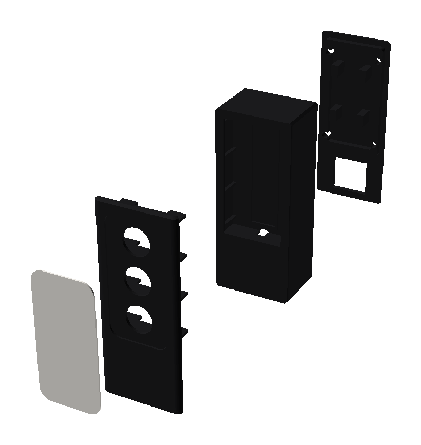
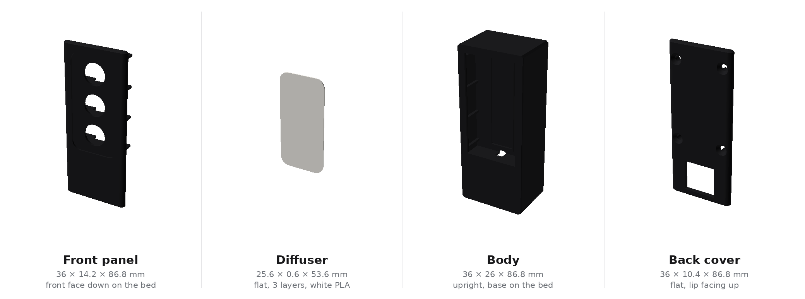
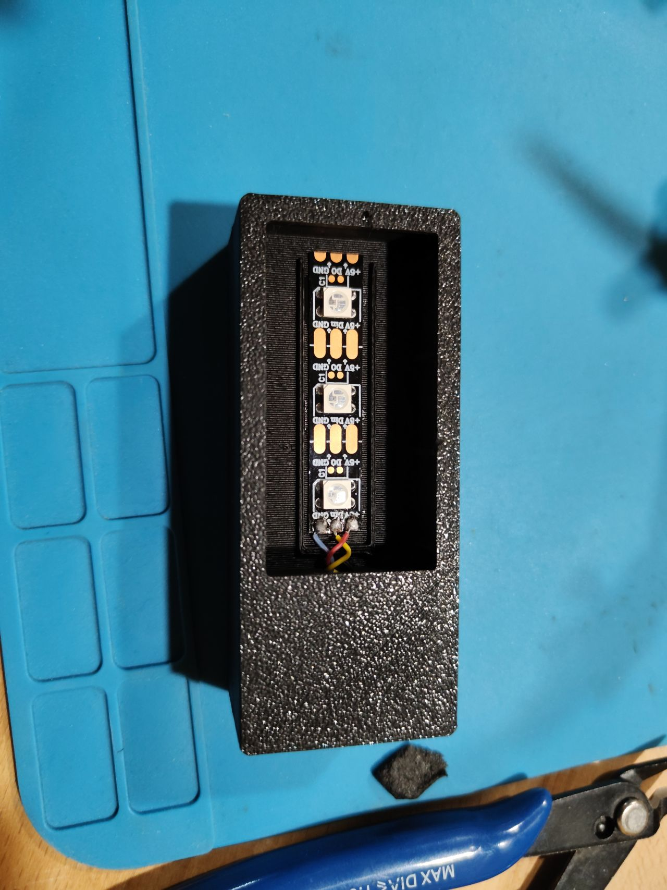
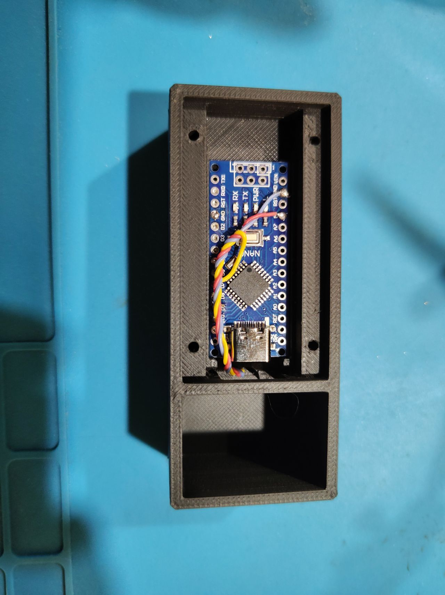
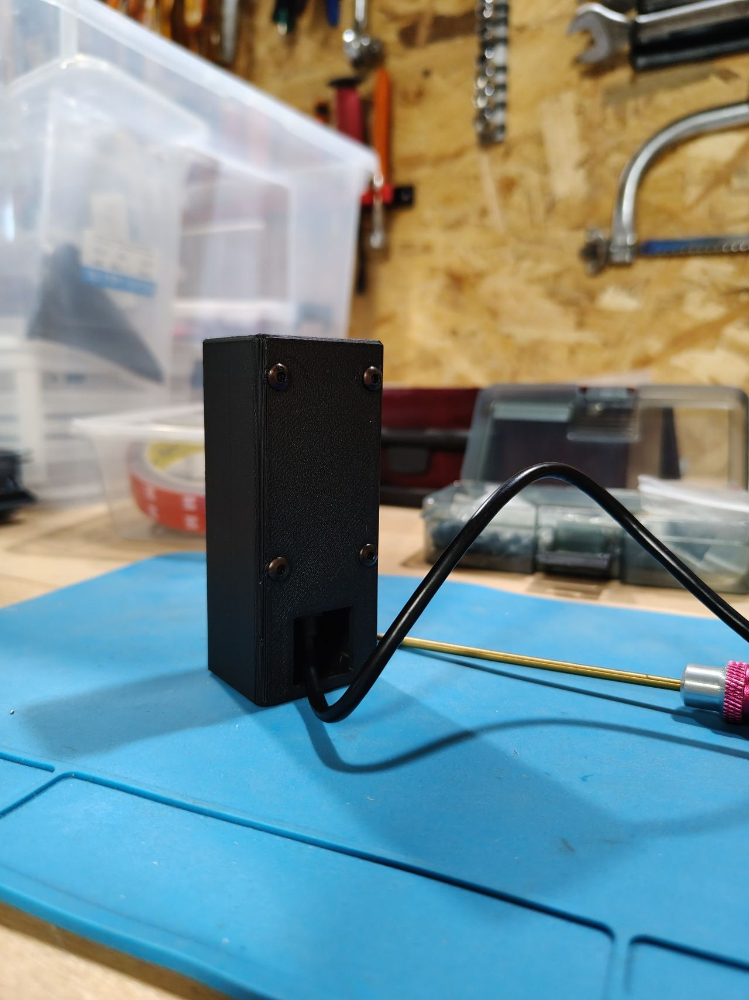

# Feu de statut Claude Code — montage (v7)

Encombrement assemblé : **36 × 30,4 × 86,8 mm**.

Ruban 60 LED/m : pas de **16,67 mm** entre LEDs, donc un segment de 3 LEDs
mesure **50 mm**. Les trois fenêtres font Ø12 mm.

Les trois pièces de coque sont découpées dans un même volume maître : le profil
extérieur est continu d'une pièce à l'autre, sans décrochement aux joints. Arêtes
verticales arrondies à R3, casse d'arête de 1 mm en haut et en bas.

Le fond de la baie câble est plein et la sortie de câble est surélevée de 3,5 mm :
le boîtier repose à plat sur toute son empreinte, le câble ne porte pas sur le bureau.

La façade est séparée du corps : la chambre optique s'ouvre par l'avant, donc le
ruban se colle à plat sur la cloison avant de refermer. Les ailettes
anti-diaphonie sont portées par la façade et viennent enjamber le ruban.

## Pièces

| Fichier | Qté | Matière |
|---|---|---|
| `traffic_light_body_black.stl` | 1 | PLA opaque |
| `traffic_light_faceplate_black.stl` | 1 | PLA opaque |
| `traffic_light_diffuser_white.stl` | 1 | PLA blanc / translucide |
| `traffic_light_cover_black.stl` | 1 | PLA opaque |

Visserie : 4 × M3, 8–10 mm (avant-trous Ø2,5 en place). Pas besoin qu'elles
soient autotaraudeuses — des vis filetées classiques passent très bien dans
ces avant-trous aussi.

## Impression

- **Corps** : debout, fond sur le plateau. Sans supports. Un pontage d'environ
  24 mm sous le plancher, au-dessus de la baie câble — rien de critique en PLA.
- **Façade** : posée sur sa face avant, ailettes vers le haut. Sans supports.
  La casse d'arête de 1 mm en bas de pièce se pose bien à plat sur le plateau.
- **Diffuseur** : à plat. 0,6 mm = 3 couches à 0,2 mm, 3 périmètres, 100 % de remplissage.
- **Capot** : plaque à plat, lèvre vers le haut. Sans supports.

Le diffuseur fait 0,6 mm pour un lamage de 0,8 mm : il reste 0,2 mm pour la colle
et il affleure. Si tu le trouves encore trop opaque, descends `diff_t` à 0,4 mm
(2 couches) dans le `.scad`.

## Câblage

Ruban WS2812B, segment de 3 LEDs = 50 mm (pas de 16,67 mm) :

| Ruban | Nano |
|---|---|
| 5V | 5V |
| GND | GND |
| DIN | D6 |

Les 3 LEDs tirent ~180 mA au maximum en blanc plein, l'USB suffit. Pas besoin
de résistance sur DIN ni de condensateur sur ce montage (3 LEDs, fil court
dans un boîtier fermé) — bonus fiabilité facultatif si le ruban grandit un
jour : résistance 330 Ω en série sur DIN, condensateur 1000 µF entre 5V et
GND au plus près du ruban.

## Assemblage

1. Coller le ruban sur la cloison, par l'ouverture avant. Une butée basse et deux
   ergots latéraux donnent la position exacte, adhésif contre la cloison, LEDs vers l'avant.
2. Passer les trois fils par le trou Ø6 situé sous le ruban, vers le compartiment Nano.

   

3. Coller le diffuseur dans le lamage de la façade.
4. Emboîter la façade sur l'avant du corps (cadre de centrage, jeu de 0,35 mm par côté)
   et la coller. Ses ailettes viennent se placer de part et d'autre du ruban.
5. Glisser le Nano par l'arrière entre les glissières, USB-C vers le bas, composants
   vers l'arrière. Le connecteur tombe en face de l'ouverture du plancher.

   

6. Refermer le capot, ses 4 plots plaquent la carte. Visser.
7. Brancher le câble USB-C : la prise passe par la fenêtre arrière du socle
   (18 × 17 mm, largement de quoi passer un surmoulage de 12 × 7 mm), remonte dans
   la baie et s'enfiche par le dessous dans le connecteur. Le câble ressort par la
   même fenêtre, 3,5 mm au-dessus du plan de pose.

   

## Retouches

Paramètres en tête de `traffic_light.scad` : `led_pitch` (33,33 pour du 30 LED/m, 6,94 pour du 144 LED/m — la longueur du ruban, la hauteur du boîtier et la position des fenêtres suivent automatiquement),
`nano_l` / `nano_w` (autre carte), `win_d` (plafonné à `led_pitch` moins `fin_t`, soit 15,4 mm ici),
`diff_t` et `diff_recess` (diffuseur), `plinth_h` (hauteur du socle, dimensionnée
ici pour une prise USB-C droite) et `cable_z0` (hauteur de la sortie de câble).
