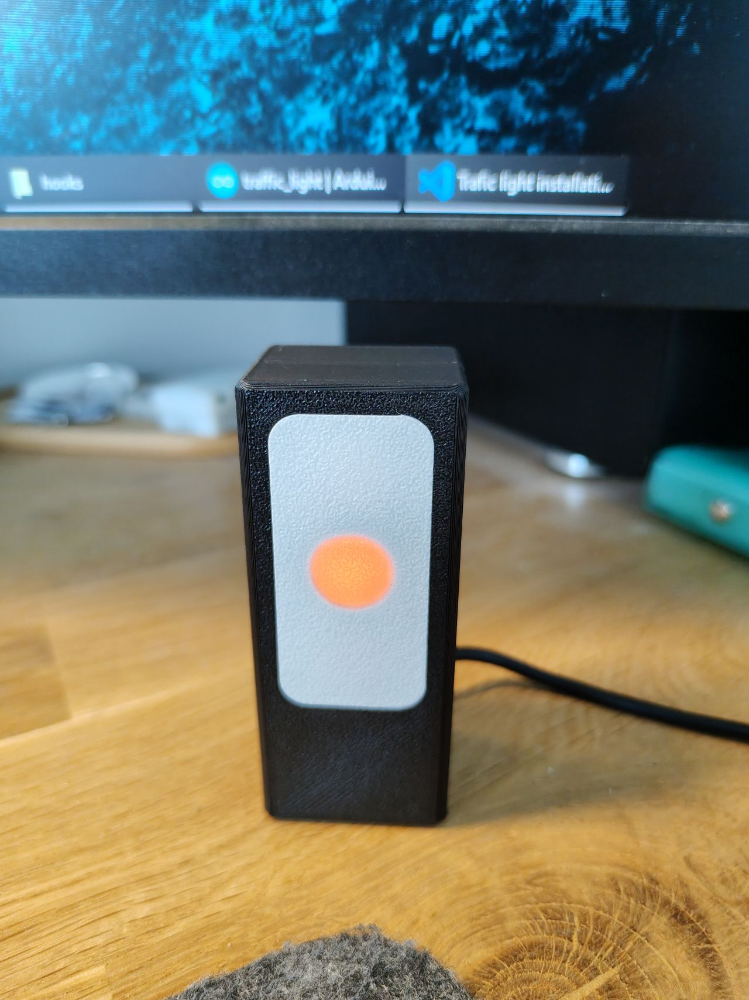
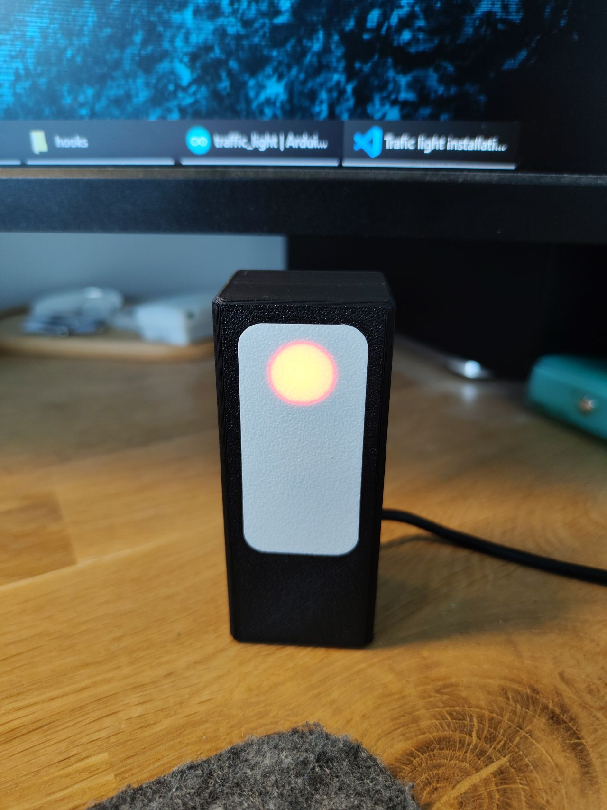
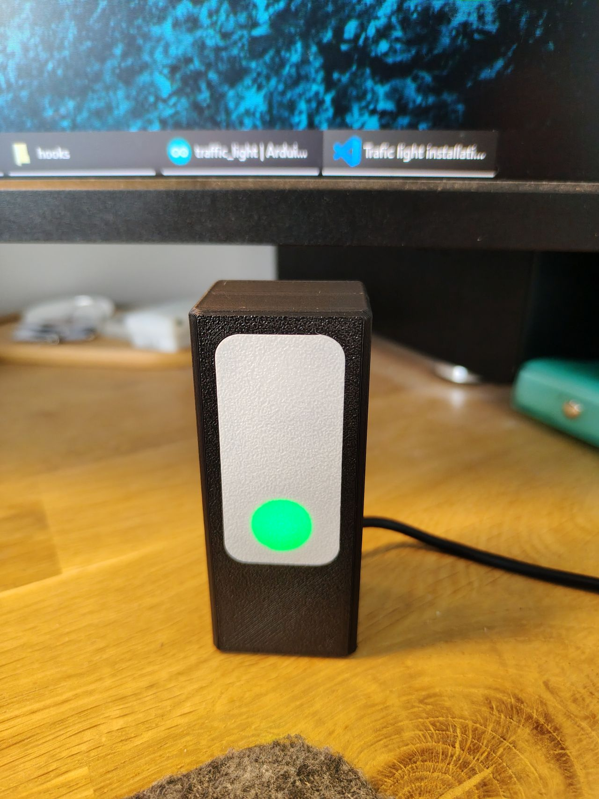
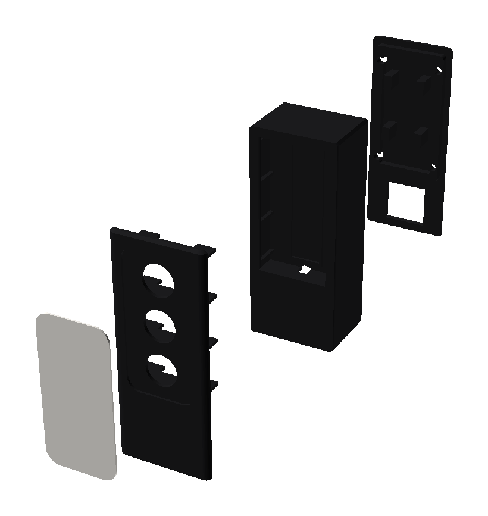
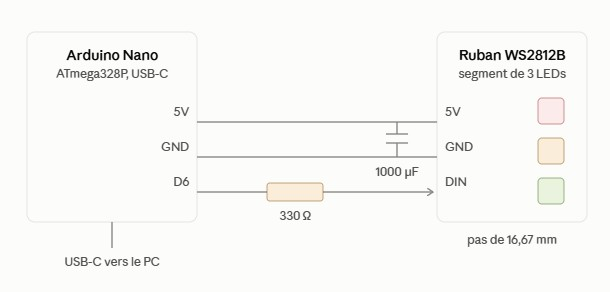

# Claude Code Traffic Light

A physical status light for [Claude Code](https://claude.com/claude-code): a
little 3-LED box on your desk (red / orange / green) wired to an Arduino Nano
that shows what Claude is doing without you having to look at a terminal —
working, waiting on you, or done.

<p>
  
  
  
</p>

## Features

- **Orange** while Claude is working, **red** when it needs your approval or
  input, **green** when it's done — red blinking vs. solid tells apart
  "waiting for a permission" from "waiting for a prompt".
- **Multiple Claude Code instances at once**: the bridge tracks one state per
  instance (by parent process PID) and merges them, so one window finishing
  can't turn off another window's red by mistake.
- **Global, not per-project**: installs once into your user-level Claude Code
  settings and hooks — works the same in every project on the machine.
- Green fades out gracefully: solid green for a minute, then a soft white
  Knight Rider-style sweep across the three LEDs, then off — only after real
  work happened, never just from the bridge starting up.
- The serial port releases itself once the light goes fully dark, so you can
  reflash the board without hunting down and killing a background process.
- Board auto-detected by USB vendor ID — no COM port number to configure, and
  it survives switching USB ports.

## How it works

```
Claude Code hook -> traffic-light.ps1 working -> named pipe -> traffic-light.ps1 (no argument) -> USB serial -> Nano
                      client mode                 pure local    bridge mode, resident
```

Claude Code hooks fire a fresh, short-lived process per event, which can't
hold the serial port open — and opening that port resets the board. So a
resident "bridge" process holds the port permanently and merges state from
every running instance, while each hook just fires a throwaway "client" that
tells the bridge what happened over a local named pipe.

## Components

| Part | Notes |
|---|---|
| Arduino Nano (or clone) | ATmega328P, "Old Bootloader" setting on most clones |
| WS2812B addressable LED strip | 3-LED segment, cut from a reel |
| USB-A to USB-C (or Mini/Micro) cable | Nano's USB port to the PC |
| 3D-printed enclosure (4 parts) | STL files in `3D/`, see `3D/assembly.md` |
| 4 × M3 screws, 8–10 mm | Holds the cover on. Self-tapping isn't required — regular machine screws into the pilot holes work fine too |
| *(optional)* 330 Ω resistor + 1000 µF capacitor | Only needed if you scale this up to a longer strip — see the reliability note in `README-software.md` |





## Getting started

- Building the enclosure and wiring the strip: [`3D/assembly.md`](3D/assembly.md)
- Flashing the firmware, installing the script, and merging the hooks:
  [`README-software.md`](README-software.md)
- Handing the whole thing to a fresh Claude Code session to install for you:
  [`INSTALL.md`](INSTALL.md)

## Repository layout

```
traffic-light.ps1              the bridge/client script (PowerShell)
traffic-light-launcher.vbs     starts the bridge with no console window
traffic-light-task.xml         scheduled task: auto-start at logon and on resume from sleep
settings-hooks.json            hook entries to merge into Claude Code's settings.json
traffic_light/traffic_light.ino   Arduino Nano firmware (FastLED)
3D/                            enclosure STLs + assembly guide
photos/                        product and assembly photos used in the docs
INSTALL.md                     install plan for Claude Code to follow
README-software.md             software reference: protocol, hooks, troubleshooting
```

French versions of the docs are available alongside each file with a `_FR`
suffix (`README_FR.md`, `README-software_FR.md`, `3D/assembly_FR.md`).
