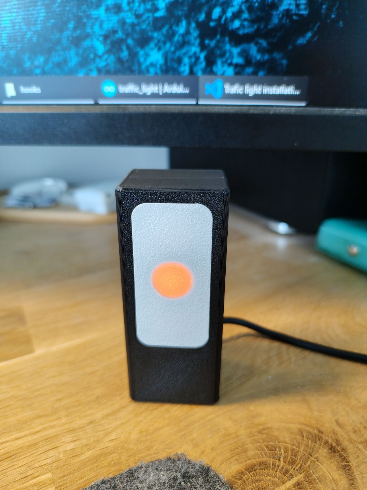
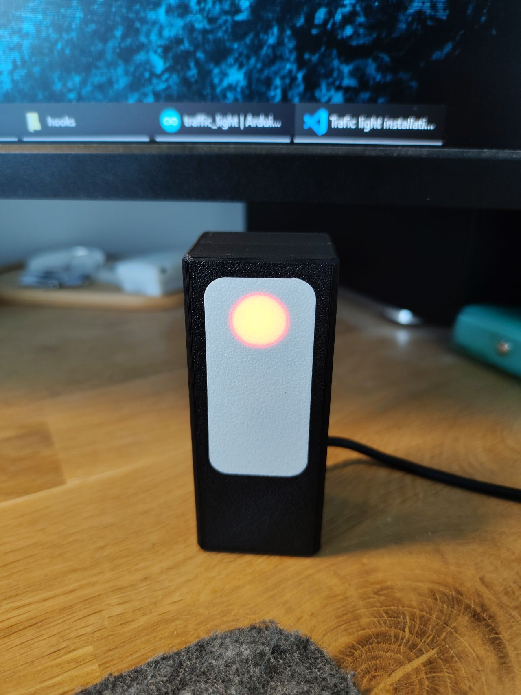
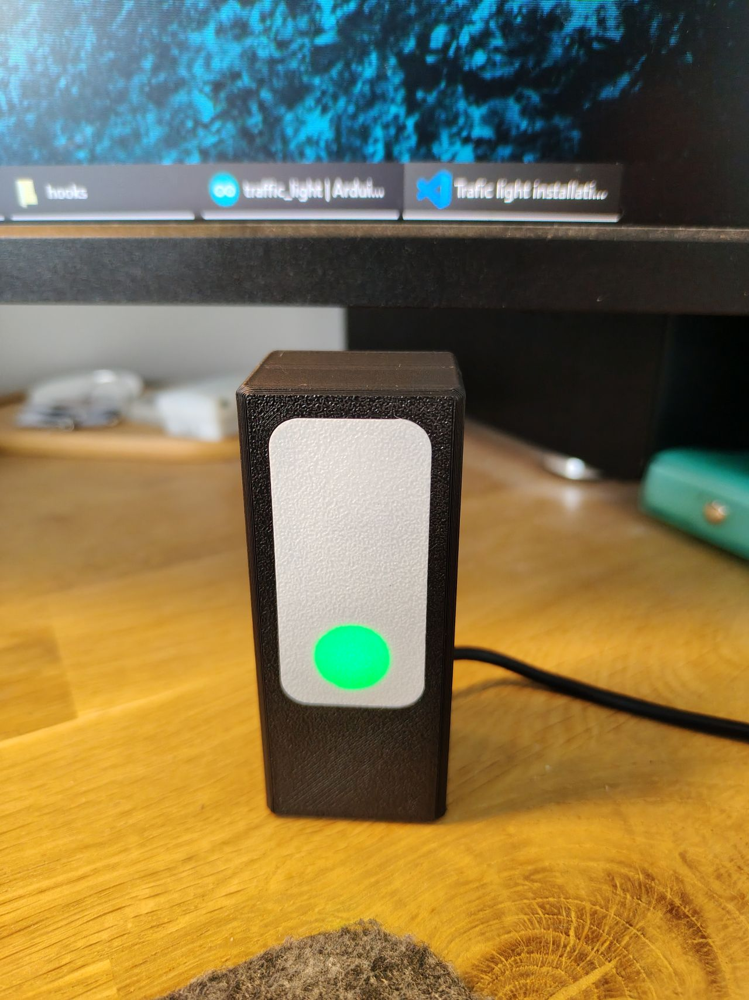
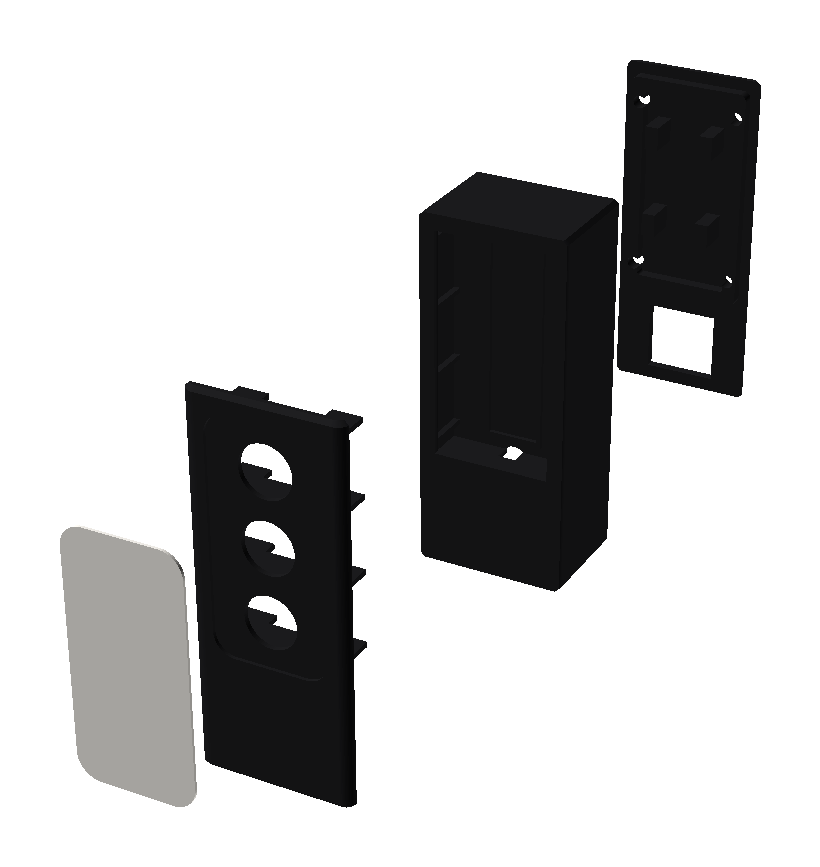
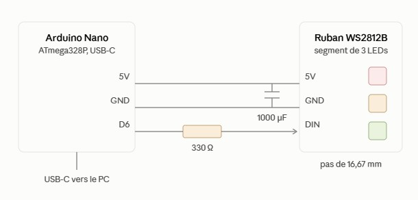

# Feu de statut Claude Code

Un feu de statut physique pour [Claude Code](https://claude.com/claude-code) :
un petit boîtier à 3 LEDs (rouge / orange / vert) posé sur le bureau, relié à
un Arduino Nano, qui montre ce que fait Claude sans avoir à regarder un
terminal — en train de travailler, en attente d'une action de ta part, ou
terminé.

<p>
  
  
  
</p>

## Fonctionnalités

- **Orange** pendant que Claude travaille, **rouge** quand il attend une
  validation ou une entrée, **vert** quand c'est fini — rouge clignotant vs.
  fixe permet de distinguer "attend une permission" de "attend une entrée".
- **Plusieurs instances Claude Code en même temps** : le pont suit un état
  par instance (via le PID du processus parent) et fusionne le tout, pour
  qu'une fenêtre qui se termine ne puisse pas éteindre par erreur le rouge
  d'une autre fenêtre.
- **Global, pas par projet** : s'installe une fois dans la configuration
  utilisateur de Claude Code — fonctionne pareil dans tous les projets de la
  machine.
- Extinction en douceur : vert franc pendant une minute, puis un balayage
  blanc doux façon K2000 sur les trois LEDs, puis extinction — uniquement
  après un vrai travail, jamais juste parce que le pont démarre.
- Le port série se libère tout seul une fois le feu complètement éteint, donc
  pas besoin de chasser puis tuer un processus en arrière-plan pour reflasher
  la carte.
- Détection automatique de la carte par identifiant USB — aucun numéro de
  port COM à renseigner, et ça survit à un changement de prise USB.

## Fonctionnement

```
hook Claude Code -> traffic-light.ps1 working -> named pipe -> traffic-light.ps1 (sans argument) -> USB série -> Nano
                      mode client                 local pur     mode pont, résident
```

Les hooks Claude Code lancent un processus neuf et éphémère à chaque
événement, qui ne peut donc pas garder le port série ouvert — et ouvrir ce
port réinitialise la carte. D'où un processus "pont" résident qui garde le
port ouvert en permanence et fusionne l'état de toutes les instances en
cours, pendant que chaque hook se contente de lancer un "client" jetable qui
prévient le pont via un named pipe local.

## Composants

| Pièce | Remarques |
|---|---|
| Arduino Nano (ou clone) | ATmega328P, réglage "Old Bootloader" sur la plupart des clones |
| Ruban de LEDs adressables WS2812B | Segment de 3 LEDs, découpé dans une bobine |
| Câble USB-A vers USB-C (ou Mini/Micro) | Port USB du Nano vers le PC |
| Boîtier imprimé en 3D (4 pièces) | Fichiers STL dans `3D/`, voir `3D/assembly_FR.md` |
| 4 × vis M3, 8–10 mm | Maintiennent le capot. Pas besoin qu'elles soient autotaraudeuses — des vis filetées classiques dans les avant-trous fonctionnent aussi |
| *(facultatif)* résistance 330 Ω + condensateur 1000 µF | Utile seulement si le montage grandit vers un ruban plus long — voir la note fiabilité dans `README-software_FR.md` |





## Pour commencer

- Monter le boîtier et câbler le ruban : [`3D/assembly_FR.md`](3D/assembly_FR.md)
- Flasher le firmware, installer le script et fusionner les hooks :
  [`README-software_FR.md`](README-software_FR.md)
- Confier l'ensemble à une session Claude Code neuve pour qu'elle installe
  tout à ta place : [`INSTALL.md`](INSTALL.md)

## Structure du dépôt

```
traffic-light.ps1              le script pont/client (PowerShell)
traffic-light-launcher.vbs     lance le pont sans fenêtre console
traffic-light-task.xml         tâche planifiée : démarrage au logon et en sortie de veille
settings-hooks.json            entrées de hooks à fusionner dans le settings.json de Claude Code
traffic_light/traffic_light.ino   firmware Arduino Nano (FastLED)
3D/                            STL du boîtier + guide de montage
photos/                        photos produit et montage utilisées dans les docs
INSTALL.md                     plan d'installation à destination de Claude Code
README-software_FR.md          référence logicielle : protocole, hooks, dépannage
```

Les versions anglaises sont les fichiers sans suffixe (`README.md`,
`README-software.md`, `3D/assembly.md`).
